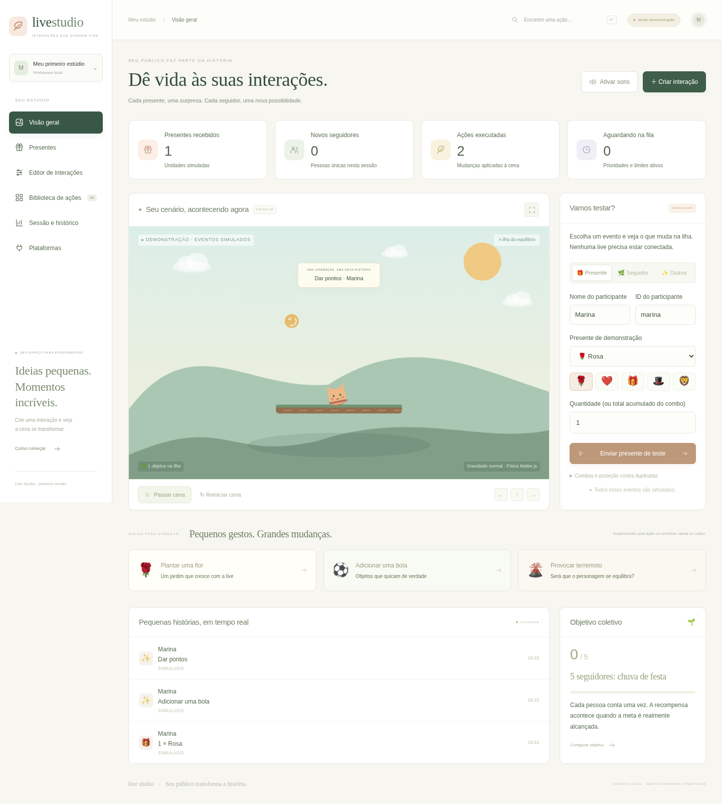

# Live Studio

Um estúdio de interações em português: presentes e seguidores simulados mudam uma ilha com física 2D, personagem, objetos, jardim e minigames. Editor visual QUANDO → ENTÃO, sem alterar código.



O `index.html` da pasta principal também abre este mesmo estúdio. Para a prévia pelo terminal, execute `npm start` na raiz e abra http://localhost:3000.

## Começar sem instalar nada

1. Baixe o projeto como ZIP e escolha **Extrair tudo**. Não abra os arquivos dentro do ZIP.
2. Entre na pasta **live-studio**.
3. Abra **TESTAR.html** com Google Chrome ou Microsoft Edge atualizado.
4. Clique **Ativar sons** e depois **Enviar presente de teste**. A Rosa faz nascer uma flor.
5. Leia **TUTORIAL.html**, também disponível sem internet.

O arquivo TESTAR.html contém React, Matter.js, estilos e desenhos. Não usa CDN, conta externa, Python ou Node. Regras ficam no armazenamento do navegador, quando permitido: use **Sessão e histórico → Exportar regras** para guardar uma cópia. A sessão, pontos, objetos e contadores reiniciam ao fechar/recarregar. A opção “Nova sessão” também os reinicia. “Reiniciar cena” preserva os contadores e a proteção contra duplicatas.

## O que está funcionando

- **60 ações em oito categorias**: natureza, objetos, animais, personagem, física, celebrações, cenário e jogo. Sons sintetizados com assinaturas distintas; animações e efeitos desenhados em Canvas, sem arquivos externos. A ação “Som” é deliberadamente apenas sonora.
- Dez presentes de exemplo, cada um com consequência: flor, corações, caixa com surpresa física, chapéu, leão, foguete, cristais, festa, pontos e coroa. Os IDs `studio-*` são exemplos locais, não IDs oficiais.
- Seguidores: sequência, sorteio ou combinação; nome em tela, contador por pessoa e metas coletivas. O mesmo ID de pessoa conta uma vez por sessão.
- Editor: até dez ações por regra, ordem, atraso, valor, mensagem, som escolhido, prioridade e seleção de ações. Regras de presente, seguidor, meta de seguidores, curtida, comentário exato ou evento personalizado.
- Física Matter.js: gravidade, colisões, vento, terremoto, plataforma que cresce, personagem que muda de tamanho, objetos que caem e derrota ao cair. Equilíbrio e coleta de estrelas possuem objetivos, fim e pontuação.
- Fila com prioridades, combos cumulativos, ranking, contadores por presente, metas de seguidores, histórico, limites de objetos/efeitos e detecção de duplicatas. Simulador permite repetir um evento e testar combos.
- Interface responsiva; sons ativados somente após clique. Sem neon ou estética futurista.

## Usar com OBS: servidor opcional

Para testar sozinho, basta TESTAR.html. Para compartilhar a mesma cena entre painel e OBS:

1. Instale o **Node.js LTS 22 ou 24** em https://nodejs.org/ e reabra o terminal.
2. No Windows, abra **INICIAR-SERVIDOR.bat**. Ele mantém a janela aberta e mostra erros.
3. Abra http://127.0.0.1:8780 no navegador. Não feche o terminal enquanto usar.
4. No OBS, adicione uma **Fonte de navegador**, largura 1920 e altura 1080, URL `http://127.0.0.1:8780/overlay`.
5. Para vertical, use 1080 × 1920 e `/overlay?layout=vertical`. Para fundo transparente, acrescente `&transparent=1`.
6. Para ouvir no overlay, use **Interagir** no OBS e clique na cena. Ative o áudio em uma única fonte para evitar som duplicado.

O painel e overlay recebem o mesmo estado pelo WebSocket. Não adicione TESTAR.html como uma segunda cena independente; use a URL `/overlay`. O servidor só aceita conexões locais. Internet é necessária na primeira instalação das dependências, e o arquivo portátil funciona offline.

Alternativa no terminal, dentro de live-studio:

```sh
npm ci --omit=dev --ignore-scripts
npm start
```

Os arquivos compilados `build/` e `dist/` acompanham a distribuição. Regras do servidor ficam em `.data/rules.json`, separadas das regras do arquivo local. Só configurações persistem; a sessão reinicia junto com o processo. Para usar suas regras locais no servidor, exporte e importe pelo painel.

## Plataformas: limites explícitos

**Não há conexão real implementada com TikTok, YouTube ou Twitch nesta versão.** Há um contrato para futuros adaptadores e uma tela que explica as permissões e limitações. Nenhuma contagem total é usada como evento individual de seguidor. Nenhum presente de exemplo é anunciado como presente oficial. Veja [docs/INTEGRACOES.md](docs/INTEGRACOES.md).

## Regras da fila

Cada evento tem ID; duplicatas não reaplicam a recompensa. Um combo usa pessoa + presente + ID do combo e uma contagem cumulativa: 1 → 3 → 3 adiciona 1 + 2 + 0 presentes. Eventos especiais passam à frente das ações pendentes prontas; atrasos não bloqueiam outros trabalhos. A execução espaça ações em pelo menos 180 ms. Até 200 trabalhos aguardam. Eventos recusados por fila cheia não contam; podem ser reenviados com o mesmo ID. Há até 50 mil IDs protegidos por sessão; ao atingir esse limite, inicie uma nova sessão. O histórico retém as 120 entradas mais recentes; o painel mostra até 40. Objetos físicos temporários expiram, decorações permanecem até uma hora; os limites removem os mais antigos. Ranking mostra os dez participantes com maior pontuação positiva. Metas de seguidores premiam a comunidade uma vez por regra/sessão.

A quantidade de um presente multiplica sua consequência dentro dos limites de cada ação. Existem limites para manter o desempenho: por exemplo, ações de chuva criam lotes limitados em vez de milhares de corpos de uma vez. Pausar congela física, fila e cronômetros; eventos novos aguardam. Na versão portátil, mantenha a aba aberta e visível: navegadores podem reduzir o ritmo de abas em segundo plano. Para transmissão, prefira o servidor opcional, cujo relógio roda fora da aba.

## Desenvolvimento

```sh
npm ci --ignore-scripts
npm run build
npm test
npm start
```

`npm run dev` abre o desenvolvimento Vite; `npm run build` atualiza TESTAR.html e os arquivos compilados do servidor. `npm test` executa os testes reais do motor e da API. O servidor compilado precisa estar atualizado antes dos testes da API. Veja [docs/VALIDACAO.md](docs/VALIDACAO.md) para o resultado verificado e as limitações de teste.

Os testes de navegador podem ser repetidos com `npx playwright install chromium` e `npm run test:browser`, após instalar as dependências de desenvolvimento e compilar. Eles usam servidor e dados temporários próprios.
